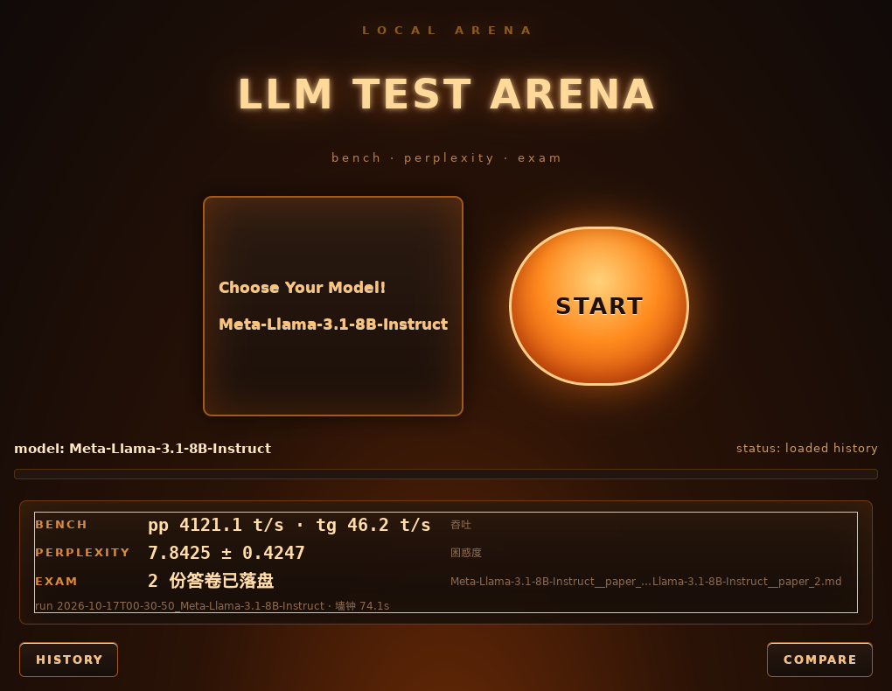

# Local Arena

**A local-first benchmark harness for GGUF models — throughput, perplexity, and long-form exam answers, with a GTK3 desktop UI and a headless CLI.**

[English](#english) · [中文](#中文)



---

## English

### What it is

Local Arena answers one practical question: **how fast and how good is this GGUF model on *my* machine?**

It does not try to be a public leaderboard. It runs three complementary tests against the same model,
keeps the raw evidence, and stores every result in an append-only history so that different models can be
compared under identical workload conditions.

The project is intentionally small and dependency-light: the core is pure Python standard library, the
desktop UI is GTK3 via PyGObject, and all model execution is delegated to a locally built
[llama.cpp](https://github.com/ggml-org/llama.cpp).

### What it measures

| Stage | Tool | Workload | Recorded result |
|---|---|---|---|
| `BENCH` | `llama-bench` | prompt 512 / generation 128, 3 repetitions | prompt processing and token generation `t/s` |
| `PERPLEXITY` | `llama-perplexity` | the **full** `wiki.test.raw` corpus, `n_ctx=512`, `--chunks -1` | perplexity ± standard error, actual chunk count reported by the tool |
| `EXAM` | `llama-server` + `/v1/chat/completions` | two 30-question Chinese papers, one independent request per question, `temperature=0`, `seed=42` | answer files, per-question JSON evidence, question coverage |

Key design choices:

- **Completion condition, not an arbitrary token cap.** The exam runs with `max_tokens=-1` and perplexity
  with `--chunks -1`; a test is done when the model finishes or the corpus is exhausted. Wall-clock timeouts
  only act as a safety net.
- **No automatic grading.** Exam answers are meant for human reading. The tool verifies *coverage*
  (which questions actually received a non-empty answer), not correctness.
- **Only the official profile enters comparisons.** `quick` is a self-test with tiny workloads and is
  structurally excluded from the comparison table.
- **Evidence-first.** Raw stdout/stderr, server logs, per-question request/response JSON, a JSONL history,
  and a protocol marker are all written to disk.

### Highlights

- GTK3 desktop UI and a headless CLI sharing the same session/runner code.
- One model per run, deliberately: this avoids VRAM-release problems between models and keeps records clean.
- Graceful cancellation: `Ctrl-C`, `SIGTERM`, `SIGHUP`, and window close all terminate the whole child
  process group and persist completed work.
- Models larger than VRAM are not rejected; `llama.cpp`'s `-fitt` / `--fit-target` performs automatic
  partial offloading (default margin: 1 GiB).
- Zero third-party Python packages for the core; only GTK3/PyGObject for the GUI.
- 28 Architecture Decision Records (ADRs) and a mechanical traceability checker.

### Requirements

- **OS:** Linux. Developed on WSL2 + WSLg (Windows 11), but any Linux desktop with GTK3 should work.
- **Python:** 3.10+ (developed and tested with 3.14.4).
- **llama.cpp:** a local build providing these executables:
  - `llama-bench`
  - `llama-perplexity`
  - `llama-server`

  Each machine needs its own build: these binaries are tied to the OS and the GPU backend
  (a Linux CUDA build will not run on Windows or on an AMD card), and the shared libraries in
  the same directory (`libggml*`, backend `.so`/`.dll` files) must travel with them.
  The directory can be chosen in the UI with **LLAMA BIN**, or set with `ARENA_LLAMA_BIN_DIR`.
  Default: `~/llama.cpp/build/bin`. Official prebuilt release archives satisfy this requirement;
  building from source is not mandatory.
- **Models:** one or more `.gguf` files in a model directory. The model name is parsed from the filename;
  the quantization tag (e.g. `Q8_0`) is split off for display.
- **GUI only:** GTK3 and PyGObject. On Debian/Ubuntu:

  ```bash
  sudo apt install python3-gi gir1.2-gtk-3.0
  ```

  Fedora: `sudo dnf install python3-gobject gtk3` · Arch: `sudo pacman -S python-gobject gtk3`
- **Hardware:** a GPU is recommended. CPU-only inference works but will be slow. The project was developed
  against an RTX 4080 Laptop (12 GB) and llama.cpp build `b11574`.

> The UI is optional. Headless mode never imports GTK, so it can run on a headless Linux box.

### Quick start

```bash
git clone https://github.com/<your-username>/local_arena.git
cd local_arena

# Point the app at your llama.cpp build and model directory if they are not
# in the defaults (~/llama.cpp/build/bin and ~/models).
export ARENA_LLAMA_BIN_DIR="$HOME/llama.cpp/build/bin"
export ARENA_MODELS_DIR="$HOME/models"

./run_arena.sh --list-models
```

Run a fast self-test (tens of seconds, not comparable across models):

```bash
./run_arena.sh --headless --quick --model "Meta-Llama-3.1-8B-Instruct"
```

Run the full official workload (minutes; one model per process):

```bash
./run_arena.sh --headless --model "Meta-Llama-3.1-8B-Instruct"
```

Show the cross-model comparison table:

```bash
./run_arena.sh --compare
```

Launch the desktop UI:

```bash
./run_arena.sh
```

`--model` accepts the display name, the file name, or the file stem; the match must be unique.
`--list-models` prints all three forms together with size and path.

The desktop UI also has two directory buttons:

- **MODEL FOLDER** picks the directory scanned for `*.gguf`.
- **LLAMA BIN** picks the directory containing `llama-bench`, `llama-perplexity` and
  `llama-server`. The three tools are checked **before** saving: if any of them is missing or not
  executable, nothing is saved and the status line names what is missing.

Both choices are saved to `$XDG_CONFIG_HOME/local-arena/config.json` (or
`~/.config/local-arena/config.json`) and reused on the next launch.
`ARENA_MODELS_DIR` / `ARENA_LLAMA_BIN_DIR` still take precedence over the saved values.
The settings file is versioned (`version = 2`); a `version = 1` file from an older build is
migrated in memory and rewritten as v2 on the next save, so the previously saved model directory
is kept.

### CLI reference

| Command | Purpose |
|---|---|
| `./run_arena.sh` | Launch the GTK3 UI |
| `./run_arena.sh --list-models` | List `.gguf` files found in the model directory |
| `./run_arena.sh --headless --model NAME` | Run the full official workload for one model |
| `./run_arena.sh --headless --quick --model NAME` | Run the tiny self-test workload |
| `./run_arena.sh --compare` | Print the official-profile comparison table and exit |
| `--models-dir PATH` | Override the model directory for this invocation |
| `--runs-dir PATH` | Override the artifact/history directory for this invocation |

Exit codes: `0` = all trials succeeded, `1` = at least one trial failed or was cancelled,
`2` = argument or environment error.

### Configuration

All environment facts live in one place (`arena/config.py`). The following environment variables are
optional:

| Variable | Default | Meaning |
|---|---|---|
| `ARENA_ROOT` | repository root | Base directory for relative defaults |
| `ARENA_LLAMA_BIN_DIR` | saved value, else `~/llama.cpp/build/bin` | Directory containing the llama.cpp executables; wins over the saved preference |
| `ARENA_MODELS_DIR` | saved value, else `~/models` | Directory scanned for `*.gguf`; wins over the saved preference |
| `ARENA_SETTINGS_PATH` | XDG config path | Override the user-settings file (`.../local-arena/config.json`) |
| `ARENA_CONTENT_DIR` | `<root>/test_content` | Exam papers and corpora |
| `ARENA_RUNS_DIR` | `<root>/runs` | History index and run artifacts |
| `ARENA_VRAM_MARGIN_BYTES` | `1073741824` (1 GiB) | Free-VRAM margin passed to `-fitt` |

Model directory precedence is `ARENA_MODELS_DIR` → saved GUI preference → `~/models`.
The llama.cpp directory follows the same rule:
`ARENA_LLAMA_BIN_DIR` → saved GUI preference → `~/llama.cpp/build/bin`.
`--models-dir PATH` overrides only the current invocation and is never written to the settings file.
A corrupt settings file does not block startup: the app falls back to the defaults and reports the
reason in the GUI status line (or on stderr in headless mode).

Workload parameters are intentionally **not** configurable through the UI or environment:
comparison is only meaningful when every model is measured under exactly the same conditions.
Use `--quick` to switch to the self-test profile.

### Output and history

Every run creates a directory under `runs/`:

```text
runs/
├── PROTOCOL                      # name of the evaluation protocol in effect
├── arena_history.jsonl           # append-only index, one JSON record per trial
└── 2026-10-19T20-20-36_Meta-Llama-3.1-8B-Instruct/
    ├── bench.out / bench.err
    ├── perplexity.out / perplexity.err
    ├── server.log                # llama-server lifecycle + timing lines
    ├── q-paper_1-K1.json         # per-question request/response evidence
    ├── answers/
    │   ├── Meta-Llama-3.1-8B-Instruct__paper_1.md
    │   └── Meta-Llama-3.1-8B-Instruct__paper_2.md
    └── answers.txt               # plain-text export of the whole run
```

`runs/` is **generated and git-ignored**. A fresh clone creates it on first launch. The `PROTOCOL` marker
records which measurement protocol produced the numbers; changing the workload or completion conditions
requires a new protocol name and an archived history, so records from different protocols are never mixed
in one comparison table.

### Reproducibility notes

- Exam sampling is fixed at `temperature=0`, `seed=42`, one request per question, and no prompt cache reuse.
- Perplexity is bit-for-bit reproducible in the authors' measurements; exam answers are usually identical
  across runs but can diverge once due to GPU-side non-determinism, then stabilize.
- Benchmarks drift across runs (GPU clocks/power state). `reps=3` only absorbs in-process noise; do not
  over-interpret small differences between models, and do not assume numbers measured days apart are
  directly comparable.
- Environmental CUDA OOMs are recorded as failures, not retried or silently downgraded.
- A hard `SIGKILL` of the parent shell can orphan children; the app handles `SIGINT`/`SIGTERM`/`SIGHUP`
  and window close, not `SIGKILL` (a documented limitation).

### Project layout

```text
run_arena.py                # single entry point: CLI parsing, assembly, GUI/headless choice
run_arena.sh                # portable launcher (works from any directory)
arena/
├── config.py               # environment facts and workload defaults (single source)
├── settings.py             # persisted user preferences (model dir + llama.cpp dir, versioned JSON)
├── domain.py               # models, records, scoreboards (pure data)
├── runners.py              # command construction, execution, result assembly
├── parsers.py              # raw stream -> facts (bench JSON, PPL, server timing)
├── server.py               # llama-server lifecycle + per-question chat client
├── session.py              # run orchestration and protocol registration
├── store.py                # JSONL history + artifact writer
├── history.py              # archive and cross-model comparison
├── coverage.py             # question coverage checks
├── export.py               # plain-text answer export
├── paper.py                # exam paper splitting
├── process.py              # subprocess/process-group management
├── vocabulary.py           # shared names and enums
├── ui/                     # GTK3 window, views, controller, theme
└── theme/arena.css         # external theme; class names are the contract
tools/
├── check_traceability.py   # module headers, docstring contracts, ADR bi-directionality
├── check_completion.py     # verify answer coverage against the papers
└── export_answers.py       # export existing answer sheets to plain text
docs/
├── decisions/              # 28 ADRs, numbered and cross-referenced from the code
├── tracer/                 # raw experimental captures used as evidence
└── ui/                     # screenshots
test_content/
├── real_test/              # two 30-question exam papers
└── speed/                  # WikiText-2 test corpus + attribution
pre_architecture.md         # detailed design notes and measured facts
```

The source docstrings, ADRs, and design notes are written in Chinese; this README is bilingual.
The code itself uses English identifiers.

### Self-checks

```bash
# Static checks: headers, public-function contracts, ADR references, forbidden patterns
python3 tools/check_traceability.py

# After you have run at least one batch: verify answer coverage
python3 tools/check_completion.py --current-only

# Export existing answer sheets into one plain-text file per run
python3 tools/export_answers.py --all
```

`check_traceability.py` uses only the standard library (`ast` + `tokenize`) and works on a fresh clone.

### What is deliberately not in this repository

- `runs/` — generated raw logs, model answers, and history. Kept local to avoid publishing machine-specific
  logs and to keep the repository small.
- `wiki.train.raw` and `wiki.valid.raw` — unused by the default workload and large. Only
  `wiki.test.raw` is committed, because it is the corpus `llama-perplexity` actually reads.
- Model weights (`*.gguf`) — far too large and always user-supplied.
- `__pycache__/`, Windows `*:Zone.Identifier` files, and other local metadata.

`docs/tracer/` contains raw captures from the development machine, so some files include absolute paths
such as `/home/<user>/models/...`. They contain no API keys, tokens, or passwords, but you may want to
redact those paths if you publish the repository under a different identity.

The WikiText-2 test split is redistributed under **CC BY-SA 3.0**. See
[`test_content/speed/NOTICE.txt`](test_content/speed/NOTICE.txt) for source, license, and citation.
To restore the excluded splits, download `wikitext-2-raw-v1` from
[Salesforce/wikitext](https://huggingface.co/datasets/Salesforce/wikitext) and place the files in
`test_content/speed/`.

### License

**No license has been granted yet.** This repository is shared for reading and reference; all rights are
reserved by the author. If you would like to reuse, modify, or redistribute the code, please contact the
author first.

Third-party components keep their own licenses:

- [llama.cpp](https://github.com/ggml-org/llama.cpp) — MIT
- [WikiText-2](https://huggingface.co/datasets/Salesforce/wikitext) — CC BY-SA 3.0
- GTK / PyGObject — LGPL

### Acknowledgements

Built around [llama.cpp](https://github.com/ggml-org/llama.cpp) and its `llama-bench`, `llama-perplexity`,
and `llama-server` tools. The perplexity corpus is the WikiText-2 raw test split by Salesforce Research.
The UI uses GTK3 through PyGObject.

---

## 中文

### 这是什么

Local Arena 回答一个很实际的问题：**这个 GGUF 模型在“我这台机器”上到底有多快、有多好？**

它不试图做公开排行榜，而是用三种互补的测试跑同一个模型，保留原始证据，并把每次结果追加进历史库，
让不同模型能在完全相同的负载条件下横向比较。

项目刻意保持小而轻：核心只用 Python 标准库，桌面界面使用 PyGObject + GTK3，所有模型执行都交给本机
编译的 [llama.cpp](https://github.com/ggml-org/llama.cpp)。

### 测什么

| 阶段 | 工具 | 负载 | 记录的结果 |
|---|---|---|---|
| `BENCH` | `llama-bench` | prompt 512 / generation 128，重复 3 次 | 提示处理与生成吞吐 `t/s` |
| `PERPLEXITY` | `llama-perplexity` | **完整** `wiki.test.raw` 语料，`n_ctx=512`，`--chunks -1` | 困惑度 ± 标准误、工具自报的实际 chunk 数 |
| `EXAM` | `llama-server` + `/v1/chat/completions` | 两份各 30 题的中文试卷，一题一个独立请求，`temperature=0`，`seed=42` | 答卷文件、逐题 JSON 证据、题目覆盖度 |

几个关键取舍：

- **完成条件是“模型写完/语料跑完”，不是随意设的 token 上限。** 答卷使用 `max_tokens=-1`，困惑度使用
  `--chunks -1`；墙钟超时只作为兜底保护，不作为完成条件。
- **不自动判分。** 答卷是给人读的；工具只核对**覆盖度**（哪些题真的产出了非空回答），不判断对错。
- **只有正式档进入对比。** `quick` 是极小负载的自检档，结构性地排除在对比表之外。
- **证据优先。** 原始 stdout/stderr、server 日志、逐题请求/响应 JSON、JSONL 历史与协议标记都会落盘。

### 主要特性

- GTK3 桌面界面与 headless 命令行共用同一套 Session / Runner 代码。
- 一次进程只跑一个模型，刻意如此：避免模型之间显存释放不及时导致的加载失败，也让记录更干净。
- 优雅取消：`Ctrl-C`、`SIGTERM`、`SIGHUP` 与关窗都会终止整个子进程组，并把已完成的工作落盘。
- 超过显存的模型不会被拒绝；由 llama.cpp 的 `-fitt` / `--fit-target` 自动部分卸载（默认预留 1 GiB）。
- 核心零第三方 Python 依赖；只有 GUI 需要 GTK3/PyGObject。
- 28 份架构决策记录（ADR）与一个可机械执行的溯源检查器。

### 环境要求

- **系统：** Linux。开发环境为 WSL2 + WSLg（Windows 11），其他带 GTK3 的 Linux 桌面同样可用。
- **Python：** 3.10+（开发与验证使用 3.14.4）。
- **llama.cpp：** 本机编译，并确保以下可执行文件存在：
  - `llama-bench`
  - `llama-perplexity`
  - `llama-server`

  每台电脑都要有自己的一份构建：这些二进制与操作系统和 GPU 后端绑定
  （Linux 的 CUDA 构建不能在 Windows 或 AMD 显卡上跑），同目录下的运行库
  （`libggml*`、后端 `.so`/`.dll`）也必须一起带齐。目录可以在界面里用 **LLAMA BIN** 选择，
  也可以设 `ARENA_LLAMA_BIN_DIR`；默认 `~/llama.cpp/build/bin`。
  官方 release 的预编译包同样满足要求，不强制从源码编译。
- **模型：** 模型目录中的一个或多个 `.gguf` 文件。展示名从文件名解析，量化标记（如 `Q8_0`）会被拆出来单独显示。
- **仅 GUI 需要：** GTK3 与 PyGObject。Debian/Ubuntu：

  ```bash
  sudo apt install python3-gi gir1.2-gtk-3.0
  ```

  Fedora：`sudo dnf install python3-gobject gtk3` · Arch：`sudo pacman -S python-gobject gtk3`
- **硬件：** 推荐使用 GPU。纯 CPU 推理可以跑，但会很慢。项目在 RTX 4080 Laptop（12 GB）与
  llama.cpp `b11574` 上开发验证。

> UI 是可选的。headless 模式不会导入 GTK，因此可以在没有图形环境的 Linux 上运行。

### 快速开始

```bash
git clone https://github.com/<your-username>/local_arena.git
cd local_arena

# 如果你的 llama.cpp 与模型不在默认位置（~/llama.cpp/build/bin、~/models），先设置环境变量。
export ARENA_LLAMA_BIN_DIR="$HOME/llama.cpp/build/bin"
export ARENA_MODELS_DIR="$HOME/models"

./run_arena.sh --list-models
```

跑一次快速自检（数十秒；数字不参与跨模型对比）：

```bash
./run_arena.sh --headless --quick --model "Meta-Llama-3.1-8B-Instruct"
```

跑完整的正式负载（分钟级；一次只跑一个模型）：

```bash
./run_arena.sh --headless --model "Meta-Llama-3.1-8B-Instruct"
```

查看跨模型对比表：

```bash
./run_arena.sh --compare
```

启动桌面界面：

```bash
./run_arena.sh
```

`--model` 接受展示名、文件名或去掉扩展名的文件名，匹配结果必须唯一。
`--list-models` 会同时打印这三种形式、文件大小与完整路径。

桌面界面页脚有两个目录入口：

- **MODEL FOLDER** 选择扫描 `*.gguf` 的模型目录。
- **LLAMA BIN** 选择存放 `llama-bench`、`llama-perplexity`、`llama-server` 的目录。
  三个工具在**保存前**校验：缺任何一个、或没有执行权限，就不保存，并在状态行列出缺的工具名。

两项都写入 `$XDG_CONFIG_HOME/local-arena/config.json`
（未设置时为 `~/.config/local-arena/config.json`），下次启动继续使用；
`ARENA_MODELS_DIR` / `ARENA_LLAMA_BIN_DIR` 仍然优先于已保存的偏好。
配置文件带版本（`version = 2`）；旧版本（v1）会被读入并在内存里迁移，下次保存写成 v2，
已保存的模型目录不会丢。

### 命令行参考

| 命令 | 用途 |
|---|---|
| `./run_arena.sh` | 启动 GTK3 界面 |
| `./run_arena.sh --list-models` | 列出模型目录里的 `.gguf` 文件 |
| `./run_arena.sh --headless --model NAME` | 对指定模型跑完整正式负载 |
| `./run_arena.sh --headless --quick --model NAME` | 跑极小负载自检 |
| `./run_arena.sh --compare` | 打印正式档对比表后退出 |
| `--models-dir PATH` | 本次运行临时覆盖模型目录 |
| `--runs-dir PATH` | 本次运行临时覆盖产物/历史目录 |

退出码：`0` = 全部 Trial 成功；`1` = 至少一个 Trial 失败或被取消；`2` = 参数或环境错误。

### 配置

所有环境事实集中在一处（`arena/config.py`）。以下环境变量均可选：

| 变量 | 默认值 | 含义 |
|---|---|---|
| `ARENA_ROOT` | 仓库根目录 | 相对默认值的基准目录 |
| `ARENA_LLAMA_BIN_DIR` | 已保存的偏好，否则 `~/llama.cpp/build/bin` | llama.cpp 可执行文件所在目录；优先于已保存偏好 |
| `ARENA_MODELS_DIR` | 已保存的偏好，否则 `~/models` | 扫描 `*.gguf` 的模型目录；优先于已保存偏好 |
| `ARENA_SETTINGS_PATH` | XDG 配置路径 | 覆盖用户配置文件（`.../local-arena/config.json`） |
| `ARENA_CONTENT_DIR` | `<root>/test_content` | 试卷与语料目录 |
| `ARENA_RUNS_DIR` | `<root>/runs` | 历史索引与运行产物目录 |
| `ARENA_VRAM_MARGIN_BYTES` | `1073741824`（1 GiB） | 传给 `-fitt` 的显存余量 |

模型目录优先级为 `ARENA_MODELS_DIR` → GUI 已保存偏好 → `~/models`；
llama.cpp 目录遵循同一套规则：`ARENA_LLAMA_BIN_DIR` → GUI 已保存偏好 → `~/llama.cpp/build/bin`。
`--models-dir PATH` 只覆盖当前进程，不会写入配置文件。
配置文件损坏不会阻止启动：程序回退到默认值，并在 GUI 状态行（headless 下是 stderr）说明原因。

负载参数刻意**不**通过 UI 或环境变量开放：只有所有模型在完全相同的条件下测量，对比才有意义。
需要小负载自检时使用 `--quick`。

### 产物与历史

每次运行都会在 `runs/` 下创建一个目录：

```text
runs/
├── PROTOCOL                      # 当前生效的评估协议名
├── arena_history.jsonl           # 只追加的索引，一个 Trial 一行 JSON
└── 2026-10-19T20-20-36_Meta-Llama-3.1-8B-Instruct/
    ├── bench.out / bench.err
    ├── perplexity.out / perplexity.err
    ├── server.log                # llama-server 生命周期与计时行
    ├── q-paper_1-K1.json         # 逐题请求/响应证据
    ├── answers/
    │   ├── Meta-Llama-3.1-8B-Instruct__paper_1.md
    │   └── Meta-Llama-3.1-8B-Instruct__paper_2.md
    └── answers.txt               # 整轮答卷的纯文本导出
```

`runs/` 是**运行期生成并已被 git 忽略**的目录，首次启动会自动创建。`PROTOCOL` 标记记录这些数字是在哪套
测量协议下产生的；一旦改动负载或完成条件，就必须更换协议名并归档旧历史，避免不同协议的数字混进同一张对比表。

### 可复现性说明

- 答卷采样固定为 `temperature=0`、`seed=42`、一题一个独立请求、不复用 prompt cache。
- 在作者的实测中，困惑度逐位可复现；答卷通常逐字相同，但可能因 GPU 侧数值非确定性分叉一次后稳定。
- 吞吐会随 GPU 频率/功耗状态跨轮漂移。`reps=3` 只能吸收进程内抖动；不要过度解读模型之间的小差异，
  也不要把相隔数天的数字当成可直接比较。
- 环境性 CUDA OOM 会如实记为失败，不自动重试、不静默降级。
- 对父 shell 执行 `SIGKILL` 可能留下孤儿子进程；程序处理 `SIGINT`/`SIGTERM`/`SIGHUP` 与关窗，不处理
  `SIGKILL`（已知限制）。

### 目录结构

```text
run_arena.py                # 唯一入口：解析命令行、装配、选择 GUI 或 headless
run_arena.sh                # 可移植启动脚本（任意工作目录均可运行）
arena/
├── config.py               # 环境事实与负载默认值（单一来源）
├── settings.py             # 用户偏好持久化（模型目录 + llama.cpp 目录，带版本的 JSON）
├── domain.py               # 模型、记录、记分板（纯数据）
├── runners.py              # 命令行构造、执行、结果组装
├── parsers.py              # 原始流 -> 事实（bench JSON、PPL、server 计时）
├── server.py               # llama-server 生命周期与逐题问答客户端
├── session.py              # 运行编排与协议登记
├── store.py                # JSONL 历史与产物写入
├── history.py              # 归档与跨模型对比
├── coverage.py             # 题目覆盖度核对
├── export.py               # 答卷纯文本导出
├── paper.py                # 试卷切题
├── process.py              # 子进程/进程组管理
├── vocabulary.py           # 跨模块共用的名字与枚举
├── ui/                     # GTK3 窗口、视图、控制器、主题
└── theme/arena.css         # 外置主题，类名即契约
tools/
├── check_traceability.py   # 模块头、docstring 契约、ADR 双向可达性检查
├── check_completion.py     # 按试卷核对答卷覆盖度
└── export_answers.py       # 把已有答卷导出为纯文本
docs/
├── decisions/              # 28 份 ADR，编号连续，代码与文档互相引用
├── tracer/                 # 作为证据保留的原始实验抓取
└── ui/                     # 界面截图
test_content/
├── real_test/              # 两份各 30 题的能力测试卷
└── speed/                  # WikiText-2 测试语料与来源声明
pre_architecture.md         # 详细设计说明与实测事实
```

源码 docstring、ADR 与设计说明以中文撰写；本 README 为中英双语。代码标识符使用英文。

### 自检

```bash
# 静态检查：文件头、公开函数契约、ADR 引用、违禁写法
python3 tools/check_traceability.py

# 至少跑过一轮之后：核对答卷覆盖度
python3 tools/check_completion.py --current-only

# 把已有答卷导出为每轮一个纯文本文件
python3 tools/export_answers.py --all
```

`check_traceability.py` 只依赖标准库（`ast` + `tokenize`），在全新克隆上即可运行。

### 仓库里刻意不包含的内容

- `runs/` —— 生成的原始日志、模型答卷与历史索引。保留在本地，避免公开机器相关的日志，也让仓库更小。
- `wiki.train.raw` 与 `wiki.valid.raw` —— 默认负载不使用且体积较大。只提交 `wiki.test.raw`，因为它是
  `llama-perplexity` 实际读取的语料。
- 模型权重（`*.gguf`）—— 体积过大，且应由使用者自行提供。
- `__pycache__/`、Windows `*:Zone.Identifier` 等本地元数据。

`docs/tracer/` 保存的是开发机上的原始抓取，因此部分文件含 `/home/<user>/models/...` 这类绝对路径。
其中没有 API key、token 或密码；如果你打算以另一个身份发布仓库，可以先把这些路径脱敏。

WikiText-2 测试集以 **CC BY-SA 3.0** 许可再分发。来源、许可与引用信息见
[`test_content/speed/NOTICE.txt`](test_content/speed/NOTICE.txt)。若需要恢复被忽略的切分，可从
[Salesforce/wikitext](https://huggingface.co/datasets/Salesforce/wikitext) 下载 `wikitext-2-raw-v1`，
把文件放入 `test_content/speed/`。

### 许可证

**本项目暂未授予任何许可证。** 仓库仅用于阅读与参考，作者保留所有权利。如需复用、修改或再分发代码，
请先联系作者。

第三方组件遵循各自的许可证：

- [llama.cpp](https://github.com/ggml-org/llama.cpp) —— MIT
- [WikiText-2](https://huggingface.co/datasets/Salesforce/wikitext) —— CC BY-SA 3.0
- GTK / PyGObject —— LGPL

### 致谢

项目围绕 [llama.cpp](https://github.com/ggml-org/llama.cpp) 及其 `llama-bench`、`llama-perplexity`、
`llama-server` 构建。困惑度语料使用 Salesforce Research 发布的 WikiText-2 raw 测试集。
界面通过 PyGObject 使用 GTK3。
